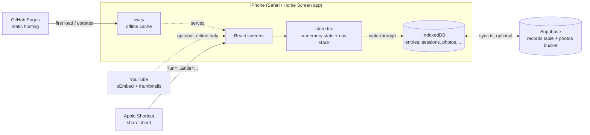
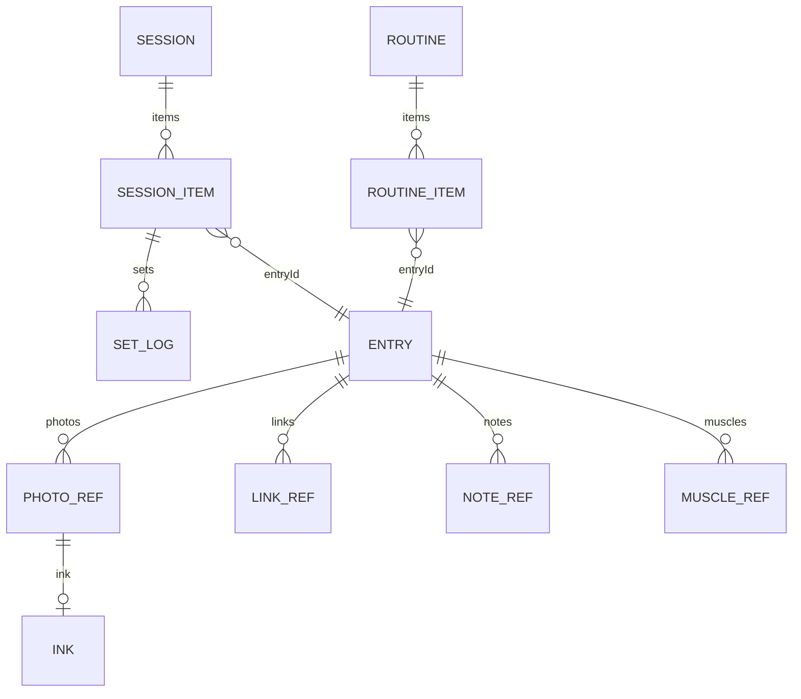

# Architecture

Personal Health Tracker is a single-page React app with no server of its own. It is built into one self-contained `index.html`, cached by a service worker, and keeps all data in the browser's IndexedDB on each device. The goals behind that shape: zero cost and works in a gym with no signal. Sync between devices is optional and goes through the user's own free Supabase project ([SYNC.md](SYNC.md)).



## Stack

| Piece | Choice | Why |
|---|---|---|
| UI | React 18.3.1 + TypeScript (strict), automatic JSX runtime | Familiar, small enough for one file |
| Build | Vite 8 + `vite-plugin-singlefile` | Inlines JS and CSS into `index.html`, so the app is one cacheable file |
| Routing | In-memory route stack in `store.tsx` | No router dependency; tabs reset the stack |
| Storage | IndexedDB through `src/db.ts`, memory fallback | Survives offline, holds photo blobs |
| Offline | `public/sw.js` | Network first for the page, cache first for fonts and YouTube thumbnails |
| Hosting | GitHub Pages via `.github/workflows/deploy.yml` | Free for public repos |
| Tests | `scripts/smoke.mjs`, Playwright at 390 x 844 | Clicks through every main flow against the production build |

There are no runtime dependencies besides `react` and `react-dom`.

## Source layout

```
src/
  main.tsx          entry: reads ?url= for share-sheet capture, registers the service worker
  App.tsx           tab bar + route switch (Screen) + which tab each route belongs to (SECTION)
  store.tsx         StoreProvider/useStore: state, navigation, persistence, seed migration, sessions
  db.ts             IndexedDB wrapper (getAll, get, put, del, clearAll, allKeys, onChange), memory fallback
  types.ts          data model and the Route union
  taxonomy.ts       regions -> muscles, equipment, movement patterns, labels, positions
  seed.ts           ~80 starter entries (sample: true); no preset routines
  swap.ts           ranking alternatives when equipment is busy
  nutrition.ts      calorie helpers: local day keys, useToday (midnight turnover), scaling label values, totals, meals
  foodSeed.ts       ~20 starter foods with their sources (USDA FoodData Central; dishes as estimates)
  snapshot.ts       draws a finished workout as a shareable PNG (canvas)
  sync.ts           optional Supabase sync: sign-in, outbox, pull/push, photo transfer (docs/SYNC.md)
  util.ts           ids, dates, image resize/crop, photo blob cache, YouTube helpers, beeps, wake lock
  env.d.ts          __APP_VERSION__ (injected from package.json by vite.config.ts)
  styles.css        all styles; dark-first tokens on :root, light overrides
  components/
    BodyMap.tsx     front/back SVG figure, one tap target per muscle (both sides)
    FormCard.tsx    cues + photo carousel with headings/notes; opens Lightbox
    Ink.tsx         PhotoView (photo + drawing), Lightbox (zoom), InkEditor, CropEditor
    LinkThumb.tsx   cover image > YouTube thumbnail > play icon
    Icon.tsx        inline stroke icons
    ui.tsx          TopBar, Sheet, Confirm, Stepper, RenameSheet, BookmarkButton (+ Save to sheet), BookmarkMark, Chip, Tag, Photo, Thumb, Empty, EntryPicker
  screens/
    Today.tsx         blank home: Start workout, Home HIIT, Save a link, Bookmarks, recent sessions
    StartWorkout.tsx  BodyPicker -> RegionScreen -> ExerciseList (equipment filter, create own)
    Library.tsx       search + kind/region/muscle filters + Bookmarked chip
    Bookmarks.tsx     Bookmarks (your lists + by section) and ListScreen
    EntryView.tsx     one exercise: form card, links, notes, muscles, swaps, history
    EntryEdit.tsx     create/edit an exercise (draft, Save/Cancel)
    FormEdit.tsx      form card editor (autosaves): cues, photos, heading, notes, draw, crop
    Session.tsx       logging: steppers, Last time card, rest timer, swap sheet, finish
    Hiit.tsx          interval setup + full-screen player
    Capture.tsx       save a link to an exercise, or to the inbox
    History.tsx       session list + SessionDetail + ShareSheet (workout image)
    Routines.tsx      saved routines (reachable from Today when any exist)
    Health.tsx        Health (daily counter), FoodList (picker / My foods), FoodEdit, AmountSheet
    Settings.tsx      timers, backup/restore, Shortcut setup, starter data, version
public/             manifest.webmanifest, icon.svg, sw.js
scripts/            smoke.mjs (Playwright), fake-supabase.mjs (sync test server), make-artifact.mjs (claude.ai preview build)
shims/              jsx-runtime shim used only by the preview build
```

## Data model (`src/types.ts`)



- **Entry**: anything you can do. `kind` is strength, mobility, stretch, warmup or hiit. `measure` is weight_reps, reps, hold or time. It also has `regions`, `muscles` (each with a role of primary, secondary or stabiliser), `equipment`, `pattern`, `cues`, `photos`, `links`, `notes`, `pinnedSwaps`, `bookmarkedAt` (set when bookmarked), `lists` (ids of your named lists) and `sample` (true for starter entries). `updatedAt === createdAt` means a starter entry is untouched.
- **PhotoRef**: `id` (a key in the `photos` store), `position` (setup, start, mid, end or other), `title` (heading above the photo), `caption` (notes below) and `ink`.
- **Ink**: drawings stored as shapes (`pen`, `line`, `arrow`, `text`) in the photo's own pixel space `{w, h}`. They are rendered as an SVG over the image, so they stay sharp and editable. Cropping shifts the marks.
- **LinkRef**: `label` (for example Proper form), `url`, `title`, `thumb` (YouTube) and `cover` (a photo id you picked, for Instagram or TikTok).
- **Session**: `items[]` of `{entryId, swappedFrom?, target, sets[]}`, `current`, and an optional `hiit` block. The running session is kept in `meta` under `active` until it is finished.
- **Food**: `name`, `brand`, `photo` (a photo id of the pack), `unit` (g or ml), `per` (the amount the label values are for) and `n` (Nutrients: kcal plus optional protein, carbs, sugar, fat, satFat, fibre in g and sodium in mg), an optional `serving` (`{label, amount}`, e.g. 1 roti = 40 g), `source` and `sample` for starter foods.
- **FoodLog**: one thing eaten: `day` (local `YYYY-MM-DD`), `meal` (breakfast, lunch, snack, dinner), `foodId`, `amount` in the food's unit, and a copy of the food's `name`, `brand`, `per` and `base` nutrients at the time, so editing or deleting a food never changes past days. Totals come from `scale(base, per, amount)`.
- **Settings**: rest timers, weight step, `kcalGoal`, `busyEquipment`, `seedVersion`, `lists` (your named lists: `{id, name, createdAt}`).

IndexedDB stores (database version 2): `entries`, `routines`, `sessions`, `inbox`, `foods`, `foodlog`, `photos` (JPEG blobs, at most 1600 px; pack photos 900 px), `meta` (settings, the active session, and sync's `sync` state and `outbox`).

## State and navigation (`src/store.tsx`)

- `Sheet` renders through a portal into `<body>`, so it always sits above the tab bar.
- `StoreProvider` loads everything from IndexedDB once (`reload`), runs the seed migration, and keeps arrays in React state. Every mutation (`saveEntry`, `saveSession`, ...) updates state and writes through to IndexedDB.
- Navigation is a stack of `Route` objects: `go` pushes, `replace` swaps the top, `back` pops and `resetTo` sets the whole stack. `go` to a tab name resets the stack to that tab. `App.tsx` renders the top route; `SECTION` decides which tab is highlighted. Only the `session` route hides the tab bar.
- `history(entryId)` returns previous `{session, item}` pairs (newest first) from finished sessions. `lastSets` is the most recent sets.
- `addToSession(entry)` starts a "Workout" session if none is running, appends the entry (or jumps to it if it is already there and unfinished) and opens the session screen.
- **Seed migration:** `SEED_VERSION` (currently 3; 3 added starter foods) in `store.tsx`. When it rises, missing starter entries and foods are added, untouched ones are refreshed, and starter routines are removed. Bump it whenever `seed.ts` changes in a way existing installs should receive.

## Swap ranking (`src/swap.ts`)

Score = 0.55 x muscle cosine + 0.25 x pattern match + 0.1 x same loading + 0.1 x used recently.

- **Muscle cosine:** muscles are weighted primary 1, secondary 0.5, stabiliser 0.2.
- **Pattern match:** 1 for the same pattern, 0.5 for related patterns (`RELATED` in `taxonomy.ts`).
- **Filtered out:** anything with muscle cosine under 0.3 or a score under 0.35, and anything that uses equipment marked busy.
- **Tiers:** Pinned by you, Closest match (0.8 and up), Same muscles new angle (0.6 and up), Other options.

## Body map (`src/components/BodyMap.tsx`)

- **Drawing:** 200 x 420 viewBox, with shapes written for the viewer's left half. Each muscle is a `<g class="zone" data-muscle>` holding the shape and its mirror, so both sides are one tap target. Every muscle has its own colour (warm at the neck to cool at the calves, like an anatomy chart); greyed-out muscles are the ones not in `only` or `highlight`. Shapes are point lists smoothed with Catmull-Rom (`blob`), and a body-coloured stroke leaves a gap between neighbours.
- **Hosts:** muscles with no shape of their own (Pec minor, Rotator cuff, Deep core, ...) map to a nearby shape through `HOST`.
- **Helpers:** `sideOf(muscle)` picks front or back (back for lats, hamstrings and calves). `sidesFor(muscles)` lists the sides a region needs.
- **Adding a muscle:** add it to `REGIONS` in `taxonomy.ts`, then either draw a shape in `FRONT` or `BACK` or add a `HOST` entry.

## Builds

- **`npm run build`:** writes to `dist/`, as one `index.html` plus manifest, icon and `sw.js`. This is what GitHub Pages serves.
- **`npm run build:artifact`:** writes `dist-artifact/artifact.html` with React loaded from cdnjs. It exists only for the claude.ai preview page. `scripts/make-artifact.mjs` strips the document skeleton.
- **Version:** `vite.config.ts` injects `__APP_VERSION__` from `package.json`, and Settings shows it.

## Testing

`npm run build && npm run smoke` starts `vite preview` on port 4179 and drives Chromium at iPhone size through every flow in [FLOWS.md](FLOWS.md). Screenshots go to `screenshots/`.

- **Browser:** set `CHROMIUM=/path/to/chrome` to use a specific browser.
- **Real screenshots:** set `FORM_SHOTS=<folder>` to test the form card editor with real images.
- **YouTube thumbnails:** requests to `i.ytimg.com` are stubbed, so the test needs no internet.
- **Sync:** `scripts/fake-supabase.mjs` serves the Supabase endpoints sync uses on port 4180, and the test syncs a second browser context with the first.
- **CI:** GitHub Actions runs the same checks on every push and pull request.
