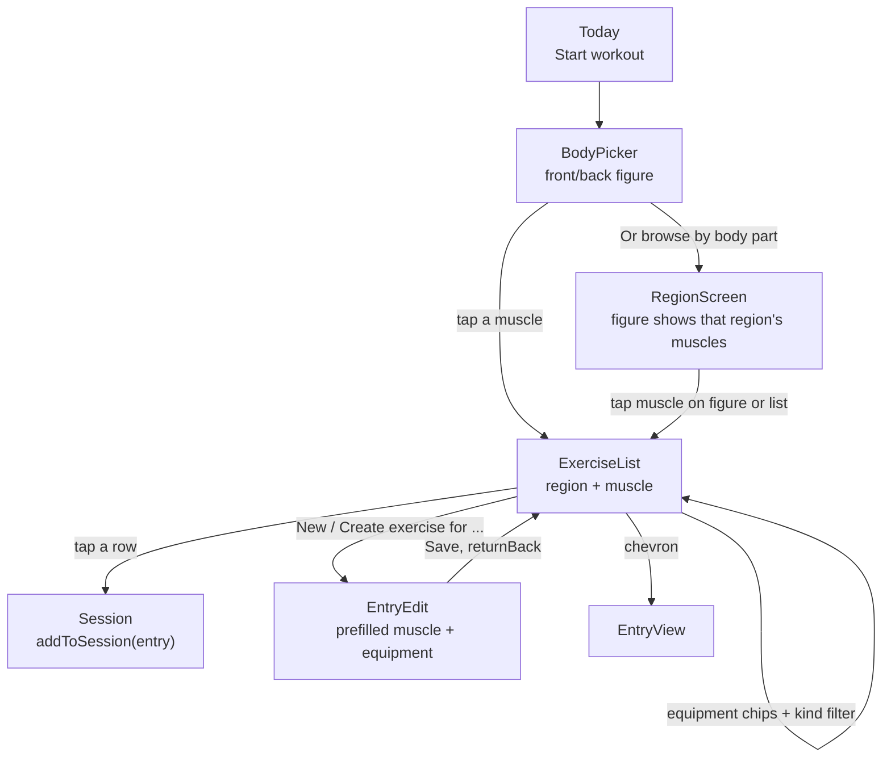
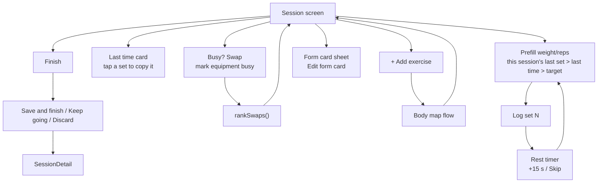
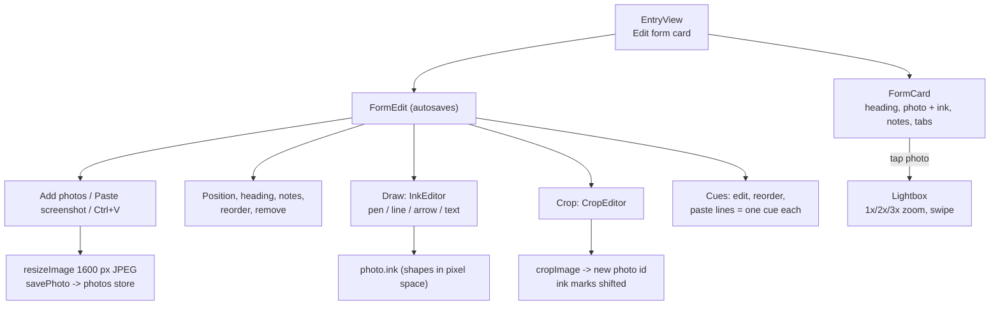
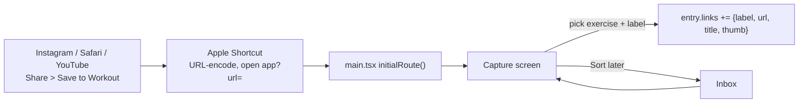
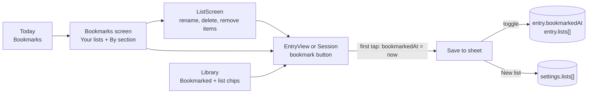
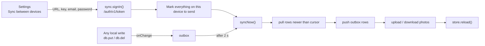

# User flows

Each flow below lists the screens and the code that does the work. The smoke test (`scripts/smoke.mjs`) covers each of these flows.

## 1. Start a workout from the body map

- **Screens:** `screens/StartWorkout.tsx` has `BodyPicker`, `RegionScreen` and `ExerciseList`. The figure is `components/BodyMap.tsx`.
- **Filters:** the equipment and kind filters are remembered per region and muscle in a module-level `Map`, so going into an exercise and back keeps them.
- **Order:** the list puts exercises where this muscle is primary first, then the most recently logged, then by name.
- **Tapping a row:** calls `store.addToSession(entry)`. It starts a session named "Workout" if none is running, and the name becomes something like "Chest + Back" from the regions when it is finished.
- **Exercise header:** the list header shows a small figure with the muscle lit, from the side it lives on (`sideOf`).

## 2. Log sets in a session

- **Screen:** `screens/Session.tsx`. The running session lives in `store.active` and in `meta/active` in IndexedDB, so it survives a reload.
- **Entering numbers:** the `Stepper` in `components/ui.tsx` is a typed numeric field (number pad, decimals) with − and + as shortcuts. It holds the typed text as a draft so values like "62." don't snap back while typing.
- **Last time:** comes from `store.history(entryId)[0]`, the newest finished session that includes the exercise.
- **Swaps:** the busy equipment is saved in `settings.busyEquipment` and reset when a new session starts. Swapping after logging sets inserts the new item after the current one. Swapping before any sets replaces it. The new item records `swappedFrom`.
- **Renaming:** the pencil next to the name opens `RenameSheet`.

## 3. Build and edit a form card

- **Code:** `screens/FormEdit.tsx`, `components/Ink.tsx` and `components/FormCard.tsx`.
- **Saving:** `FormEdit` saves on every change through `save(patch)`. It keeps a `latest` ref so quick edits in a row don't overwrite each other.
- **Tab names:** photos keep the order you set. Tab labels come from `photoLabels()`, which gives "Setup", or "Setup 1" and "Setup 2" when there are several frames for one position.
- **OneNote:** screenshots go in as they are, handwriting included. Crop removes slide text, and the drawing tools add new marks.

## 4. Save a link (share sheet, capture, inbox)

- **Code:** `screens/Capture.tsx`. Settings shows the steps for setting up the Shortcut.
- **Titles and thumbnails:** `fetchLinkInfo(url)` in `util.ts` gets the YouTube title through oEmbed when online. The thumbnail address comes from the video id (`youtubeThumb`), so it works offline, and the service worker caches the image.
- **Covers:** Instagram and TikTok don't share thumbnails, so EntryEdit lets you pick a cover image per link, stored in `link.cover`. `LinkThumb` shows the cover, else the YouTube thumbnail, else a play icon.

## 5. Library, create and edit

- **Library** (`screens/Library.tsx`): search, kind tabs, and region and muscle chips.
- **EntryView**: shows the form card, links grouped by label, notes grouped by label, muscles, the top 4 swaps (you can pin one), history with the last and best set, and "Log now" or "Add to current session".
- **EntryEdit**: works on a draft and saves on Save. Photos added during the edit are deleted again on Cancel. Tapping a muscle cycles it through primary, secondary, stabiliser and off. Links take a label, URL, title and cover. Notes take a label and body.

## 6. Home HIIT

- **Code:** `screens/Hiit.tsx`.
- **Setup:** set work, rest and rounds, and pick moves.
- **Player:** a fixed full-screen overlay with a ring countdown, beeps in the last 3 seconds, vibration and a wake lock.
- **Saving:** finishing saves a session with a `hiit` block. Anything under 30 seconds is not saved.

## 7. Backup, restore, starter data

- **Code:** `screens/Settings.tsx`.
- **Backup:** creates one JSON file with every store, photos included as data URLs. It uses the share sheet where available, otherwise a download.
- **Restore:** replaces everything on the device and runs the seed migration again. It signs the device out of sync first.
- **Remove untouched starter entries:** keeps anything edited (`updatedAt !== createdAt`), anything used in a session, and anything in a routine.
- **Footer:** shows the version.

## 8. Bookmarks and named lists

- `BookmarkButton` in `components/ui.tsx`: the first tap bookmarks the exercise and opens the "Save to" sheet. There you can toggle the bookmark, toggle each named list, or create a new list. Every change bumps `updatedAt`, so saved starter entries survive "Remove untouched starter entries".
- **Where things are stored:** list definitions are kept in `settings.lists` (`{id, name, createdAt}`), so backups include them. Membership is kept on each entry in `entry.lists`. Deleting a list removes its id from those entries and leaves the exercises alone.
- **On the exercise page:** the lists an exercise is in show as tags.
- **Bookmarks screen:** `screens/Bookmarks.tsx` groups bookmarks by section: Strength, Mobility, Stretches, Warm-ups and HIIT, newest first. When there's more than one section, tabs show a count for each.
- **Library:** the "Bookmarked" chip limits the list to bookmarks.
- **Exercise lists:** bookmarked exercises sort right after primary-muscle ones and show a small bookmark mark.

## 9. Sync between devices

- **Code:** `src/sync.ts`; the Settings section is `SyncSection` in `screens/Settings.tsx`. Setup and SQL are in [SYNC.md](SYNC.md).
- **Triggers:** after a change, on open, on return to the app, when back online, every minute, and Sync now.
- **Conflicts:** newest change wins per record. A workout in progress and today's busy equipment stay on the device.

## 10. Offline and updates

- **Service worker** (`public/sw.js`, cache `workout-v2`):
  - The page is network first, so a new deploy arrives the next time the app opens with signal.
  - The page, fonts and YouTube thumbnails are cached first.
- **Data:** stays in IndexedDB for this origin (the exact address). A new deploy never touches it. Moving to a different address needs a backup and restore.
