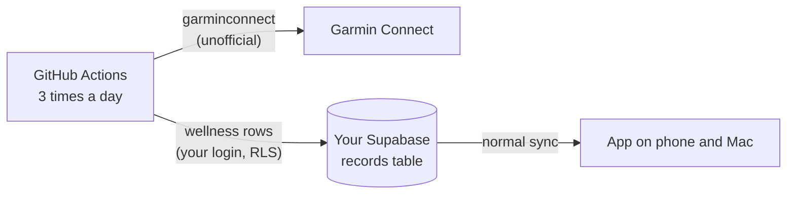

# Garmin: steps, calories burnt and sleep

You can get Garmin data into the app in two ways. Both put one record per day into the `wellness` store, so you can use either or both.

| | Export import | Auto-sync job |
|---|---|---|
| What you do | Request the export, then open the zip in the app | Add some secrets on GitHub once |
| How fresh | As fresh as your last export | Up to three times a day |
| Needs | Nothing | Sync set up ([SYNC.md](SYNC.md)) and a Garmin password stored as a GitHub secret |
| Official | Yes, it's Garmin's own export | No. It uses the unofficial `garminconnect` library and can break when Garmin changes its sign-in |
| Code | `src/garmin.ts`, `screens/Garmin.tsx` | `scripts/garmin_sync.py`, `.github/workflows/garmin-sync.yml` |

We don't use the official Garmin Health API because it needs an approved business application and a server of our own, which breaks the zero-cost rule. A web page also can't call Garmin's sign-in directly.

## Export import (in the app)

1. In a browser, sign in at connect.garmin.com and go to Account, Data Management, Export Your Data. Choose Request Data Export.
2. Garmin emails you a download link, usually within a day or two. Save the zip to Files.
3. In the app, open Health, then the Garmin card, then Import Garmin export, and pick the zip.

The zip is read on the phone. See flow 12 in [FLOWS.md](FLOWS.md).

## Auto-sync job (GitHub Actions)



Each run does four things:
- It reads the last 3 days: today, yesterday and the day before. Garmin "today" uses your Garmin profile's time zone.
- It signs in to your Supabase with the same email and password as the app, so the row-level security rules apply exactly as they do on your phone.
- It merges each day into any row already there. Fields from Garmin win, and fields only an export had are kept.
- It writes `wellness` rows. The app shows them after its next sync.

GitHub Actions is free for public repos. Run logs in a public repo are public too, so the script prints only counts and dates, never your numbers.

### Setup (once)

1. **Set up sync first.** Follow [SYNC.md](SYNC.md) and sign in on the phone. The job writes into the same Supabase project.
2. **Add the secrets.** On GitHub, open the repo, then Settings, Secrets and variables, Actions, and choose New repository secret. Add each of these:

   | Secret | Value |
   |---|---|
   | `GARMIN_EMAIL` | your Garmin Connect email |
   | `GARMIN_PASSWORD` | your Garmin Connect password |
   | `SUPABASE_URL` | the Project URL you pasted into the app |
   | `SUPABASE_KEY` | the publishable key you pasted into the app |
   | `SUPABASE_EMAIL` | the email you sign in to sync with |
   | `SUPABASE_PASSWORD` | the password you sign in to sync with |

3. **Run it once by hand.** Open Actions, choose Garmin sync, then Run workflow. To backfill, set days to up to 60. The log should end with "Supabase: wrote N days". Open the app and tap Sync now in Settings, or just wait a minute.

After that it runs by itself at about 7 am, 3 pm and 11 pm India time.

### If your Garmin account uses two-step verification (MFA)

The job can't type a code. Sign in once on your own computer and give the job the tokens:

```sh
python3 -m pip install 'garminconnect==0.3.20' curl_cffi
python3 scripts/garmin_sync.py --login
```

It asks for your email, password and the code, then prints one line of JSON. Save that line as a `GARMIN_TOKENS` secret. Garmin refreshes the tokens itself, and the job keeps the newest copy between runs, encrypted with your Supabase password in the Actions cache. If the job ever says Garmin asked for an MFA code, repeat this step.

### When it stops working

- **Garmin changed its sign-in.** You'll see a red run in Actions with a login error. Update the `garminconnect==` version in `.github/workflows/garmin-sync.yml` when the library catches up. Until then, the export import still works.
- **Garmin rate-limits or blocks the runner** (HTTP 429 or 403). The saved tokens usually avoid this. Wait a day, or set `GARMIN_TOKENS` as described above.
- **Nothing runs.** GitHub pauses scheduled workflows in a repo with no commits for 60 days. Open Actions and turn it back on.
- **Your Supabase project was paused** after a week with no use. Resume it from the Supabase dashboard.

To stop the job, delete the `GARMIN_PASSWORD` and `GARMIN_TOKENS` secrets. The job then only reports "not set up". You can also disable the workflow in Actions.

### Tests

`npm run test:garmin-sync` runs the script against `scripts/fake-supabase.mjs` with canned Garmin answers (`--fake`). It checks the rows it writes, that it merges into a day already imported, that no values go to the log, and that it skips cleanly when not set up. CI runs it on every push.
