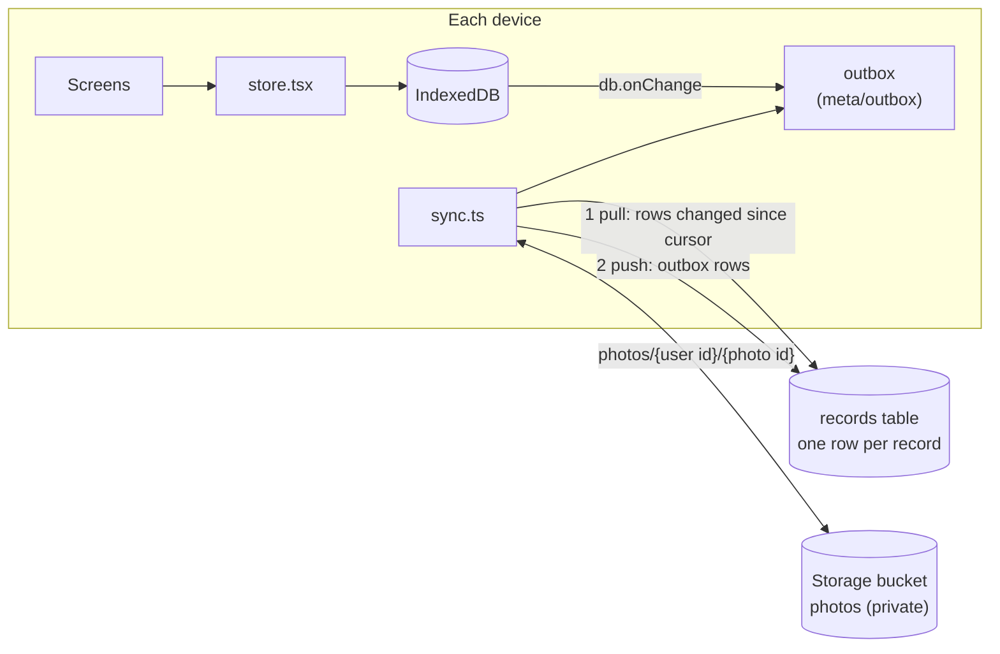

# Sync between devices (Supabase, free tier)

Sync is optional. Without it, everything stays on each device exactly as before. With it, your phone and Mac share the same exercises, form cards (photos and drawings included), links, notes, bookmarks, lists, history and settings.

## How it works



- **Still offline-first.** Every change is written to IndexedDB first, as before. `db.ts` tells `sync.ts` about each write, and it notes the key and the time in an outbox.
- **When it syncs:** two seconds after a change, when the app opens or comes back to the foreground, when the device comes back online, and every minute while the app is open. "Sync now" in Settings runs it straight away.
- **One row per record.** The `records` table holds every entry, session, routine, inbox item, food, food log and the settings as JSON, keyed by user, store and id. Deletes are kept as rows with `deleted = true`, so the other device deletes them too.
- **Newest change wins.** Each row carries `modified`, the time of the change on the device. A pull skips rows older than a local change that hasn't been sent yet, and the database ignores a push that is older than what it has.
- **Pull by server time.** The database sets `synced_at` on every write. Each device remembers the newest `synced_at` it has seen and only asks for rows after it.
- **Photos** (form cards, link covers and food pack photos) are uploaded to a private bucket once, as `photos/{user id}/{photo id}`. Photo ids never change (crop makes a new one), so there's nothing to merge. A device downloads any photo that its entries use but it doesn't have yet.
- **First sign-in on a device** sends everything on that device and pulls everything from Supabase, and the newest version of each record wins. Named lists from both devices are kept.
- **Not synced:** a workout in progress (it syncs once you finish it), busy equipment for today, and starter entries or foods you never touched (every device has them already). Foods and food logs need no change to the SQL: `store` is just text.
- **Sign in** is email and password, inside the app. This matters on iPhone, where a Home Screen app has its own storage apart from Safari, so a magic link opened in Mail would sign in Safari instead of the app.

## Set up Supabase (one time, about 10 minutes, free)

The free plan needs no card. It includes 500 MB of database and 1 GB of file storage, far more than this app needs. A free project is paused after a week with no use. Your data is safe on your devices and in the paused project; resume it from the Supabase dashboard and sync carries on.

1. **Create the project.** Sign up at [supabase.com](https://supabase.com), then New project. Pick the Free plan, any name (for example `health-tracker`), a database password (save it in your password manager, the app never needs it) and the region nearest you.
2. **Create the table and the photo bucket.** Open SQL Editor, paste the whole script below, and Run. It should finish with "Success. No rows returned".
3. **Create your login.** Open Authentication → Users → Add user → Create new user. Enter your email and a password, tick **Auto Confirm User**, and create it.
4. **Turn off new sign-ups.** Open Authentication → Sign In / Providers and turn off **Allow new users to sign up**, so nobody else can make an account in your project.
5. **Copy two values.** Click **Connect** at the top of the project (or open Project Settings → API Keys). You need the **Project URL** (`https://xxxx.supabase.co`) and the **Publishable key** (`sb_publishable_...`; the older `anon` key works too). Never use the secret or `service_role` key in the app.
6. **Sign in on each device.** In the app, open Settings → Sync between devices. Paste the Project URL and key, enter your email and password, and tap **Sign in and sync**. Do the Mac first, then the phone. On the iPhone, copy the URL and key on the Mac and paste them on the phone (Universal Clipboard), or send them to yourself in Notes.

The publishable key is safe in the app. It only identifies your project; what each person can read or write is decided by the row-level security rules below, which allow only your own rows and photos. Nothing about your project is stored in the repo.

### SQL

```sql
-- One row per record of the app, per user.
create table if not exists public.records (
  user_id uuid not null default auth.uid() references auth.users (id) on delete cascade,
  store text not null,            -- entries, sessions, routines, inbox, meta
  id text not null,
  data jsonb,
  deleted boolean not null default false,
  modified bigint not null,       -- when the change was made on the device (ms)
  synced_at timestamptz not null default clock_timestamp(),
  primary key (user_id, store, id)
);
create index if not exists records_user_synced on public.records (user_id, synced_at);

alter table public.records enable row level security;
grant select, insert, update, delete on public.records to authenticated;

drop policy if exists "Own rows only" on public.records;
create policy "Own rows only" on public.records for all to authenticated
  using ((select auth.uid()) = user_id)
  with check ((select auth.uid()) = user_id);

-- Keep the newest change, and stamp the server time used by pulls.
create or replace function public.records_keep_newest() returns trigger
language plpgsql set search_path = '' as $$
begin
  if tg_op = 'UPDATE' and new.modified < old.modified then
    return old;
  end if;
  new.synced_at := clock_timestamp();
  return new;
end $$;

drop trigger if exists records_keep_newest on public.records;
create trigger records_keep_newest before insert or update on public.records
  for each row execute function public.records_keep_newest();

-- Private bucket for form card photos and link covers: photos/{user id}/{photo id}.
insert into storage.buckets (id, name, public) values ('photos', 'photos', false)
  on conflict (id) do nothing;

drop policy if exists "Own photos read" on storage.objects;
drop policy if exists "Own photos add" on storage.objects;
drop policy if exists "Own photos change" on storage.objects;
drop policy if exists "Own photos delete" on storage.objects;
create policy "Own photos read" on storage.objects for select to authenticated
  using (bucket_id = 'photos' and (storage.foldername(name))[1] = (select auth.uid())::text);
create policy "Own photos add" on storage.objects for insert to authenticated
  with check (bucket_id = 'photos' and (storage.foldername(name))[1] = (select auth.uid())::text);
create policy "Own photos change" on storage.objects for update to authenticated
  using (bucket_id = 'photos' and (storage.foldername(name))[1] = (select auth.uid())::text);
create policy "Own photos delete" on storage.objects for delete to authenticated
  using (bucket_id = 'photos' and (storage.foldername(name))[1] = (select auth.uid())::text);
```

## Things to know

- **Signing out** stops sync on that device. Its data stays on the device.
- **Restore from a backup, or Erase everything,** signs that device out of sync first, so a restore never silently overwrites the synced copy. Sign in again to merge, and the newest version of each record wins.
- **Two edits to the same exercise** on two devices before either syncs: the later edit wins for the whole exercise.
- **If the phone says "Signed out"** (for example after a long time offline), sign in again; nothing is lost.

## Code

- `src/sync.ts`: config, sign-in with the Supabase Auth REST API (`/auth/v1/token`), token refresh, outbox, pull, push and photo transfer. It uses `fetch` directly, so there's no Supabase library in the bundle.
- `src/db.ts`: `onChange` listener; writes made by sync pass `{ silent: true }` so they aren't sent back.
- `src/util.ts`: `whenPhotoArrives` lets `Photo` and `PhotoView` show a photo as soon as sync downloads it.
- `src/screens/Settings.tsx`: the Sync section.
- `scripts/fake-supabase.mjs`: an in-memory stand-in for the same endpoints, used by the smoke test to sync two browser "devices" with no internet.
